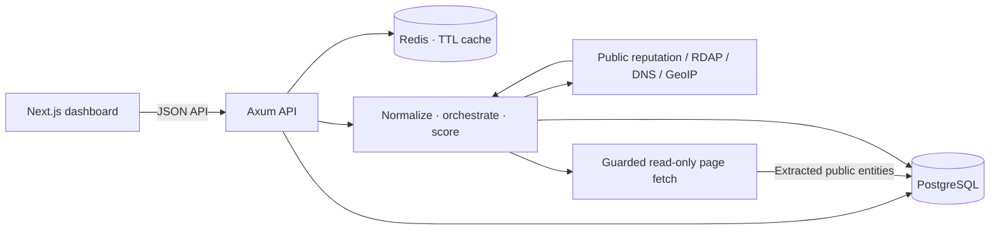

# SignalWatch — OSINT & Anti-Scam Tracker

SignalWatch is a defensive public-intelligence tracker for checking suspicious IP addresses, domains, URLs, email addresses, international phone numbers, and Bitcoin/Ethereum wallet addresses. Provider lookups run concurrently, partial failures do not hide successful findings, and the scoring rules are transparent.

> **Disclaimer:** Results are indicators, not proof. Public-source data can be incomplete or stale. Do not use this service to harass, identify, or doxx people. It performs reputation lookups only; it does not scan ports, exploit systems, bypass authentication, or access private/login-gated content.

## Architecture



The backend is a Rust Cargo workspace in `backend/`. SQLx migrations run automatically on startup. Redis holds cached search results for the configured TTL. The Next.js App Router frontend uses TanStack Query, Recharts, and React-Leaflet with OpenStreetMap tiles.

## Run with Docker Compose

Requirements: Docker Engine with Compose v2.

```powershell
Copy-Item .env.example .env
# Change POSTGRES_PASSWORD in .env before exposing the services.
docker compose up --build
```

Open `http://localhost:3000`; the API health endpoint is `http://localhost:8080/health`. Compose waits for healthy PostgreSQL and Redis services before starting the API. The API applies migrations at startup.

For a local development run, start PostgreSQL and Redis (or use Compose for those services), then run `cargo run --manifest-path backend/Cargo.toml` and `npm run dev --prefix frontend`. The backend reads `DATABASE_URL`, `REDIS_URL`, `BACKEND_PORT`, and the provider settings from its environment. The frontend reads `NEXT_PUBLIC_API_URL`.

## Environment

Copy `.env.example` to `.env`. These are the supported variables:

| Variable | Purpose | Default / notes |
|---|---|---|
| `POSTGRES_USER` | PostgreSQL user | `osint` |
| `POSTGRES_PASSWORD` | PostgreSQL password | Replace before deployment |
| `POSTGRES_DB` | PostgreSQL database | `osint_tracker` |
| `DATABASE_URL` | PostgreSQL connection URL | Compose supplies the service URL |
| `REDIS_URL` | Redis connection URL | `redis://redis:6379` in Compose |
| `REDIS_TTL_SECONDS` | Search-cache TTL | `3600` |
| `BACKEND_PORT` | Published API port on the host | `8080` |
| `FRONTEND_PORT` | Published web port | `3000` |
| `FRONTEND_ORIGIN` | Allowed browser origin | `http://localhost:3000` |
| `NEXT_PUBLIC_API_URL` | Browser-visible API origin | `http://localhost:8080` |
| `VIRUSTOTAL_API_KEY` | Optional VirusTotal API access | Skipped when empty |
| `SHODAN_API_KEY` | Optional read-only Shodan host lookup | Skipped when empty |
| `HIBP_API_KEY` | Optional breach-exposure lookup | Skipped when empty |
| `PHISHTANK_API_KEY` | Optional PhishTank check | Skipped when empty |
| `RUST_LOG` | Rust tracing filter | `info` |

Provider keys remain in backend environment variables and are never sent to the browser. Do not commit `.env`.

## API

- `GET /health` — database/cache dependency health.
- `GET /api/search?q=<indicator>` — normalize, check cache, gather provider results, correlate, score, and persist.
- `GET /api/feed?limit=30` — recent high-risk indicators and reports; email and phone values are masked.
- `GET /api/stats` — indicator counts by type, verdict, and day (last 30 days).
- `POST /api/report` — submit `{ "indicator": "...", "category": "phishing", "description": "..." }`. Categories are `phishing`, `fraud`, `impersonation`, `malware`, and `other`.

Errors use `{ "error": "bad_request", "message": "..." }`. Search and report inputs are validated; global per-client and report-specific Redis rate limits are applied. CORS is restricted to `FRONTEND_ORIGIN`.

## Safety and data handling

- Public lookup APIs are used read-only; provider keys are optional and missing keys skip those integrations.
- The page fetcher accepts only HTTP(S), manually follows at most three redirects, resolves and pins public IP addresses for each hop, blocks non-public targets, and caps response bodies at 2 MiB. It does not execute JavaScript or submit forms.
- User reports are plain text, length-limited, and rate-limited. Public feed output redacts email addresses and phone numbers.
- Email breach presence is displayed only as exposure information and does not increase scam risk.
- The scoring rules and thresholds are implemented in `backend/src/engine/scoring.rs`; a score is not a claim about a person.

## Adding a provider

1. Add a module under `backend/src/providers/` and implement the async `Provider` trait (`name`, `supports`, `lookup`).
2. Use the shared HTTP client for the five-second provider timeout; keep requests read-only and respect the source's terms and rate limits.
3. Register the provider in `create_providers` in `backend/src/providers/mod.rs`; keep optional credentials in `Config` and skip the provider when its key is absent.
4. Return a JSON `ProviderResult`, add a mock-provider test, and update scoring only when a result is a defensible risk signal.

## Validation

```powershell
cargo fmt --manifest-path backend/Cargo.toml -- --check
cargo test --manifest-path backend/Cargo.toml
cargo clippy --manifest-path backend/Cargo.toml --all-targets -- -D warnings
npm ci --prefix frontend
npm run lint --prefix frontend
npm test --prefix frontend
npm run build --prefix frontend
```
